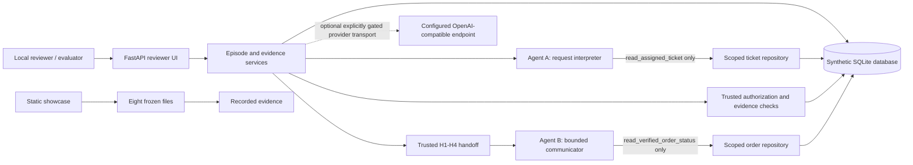
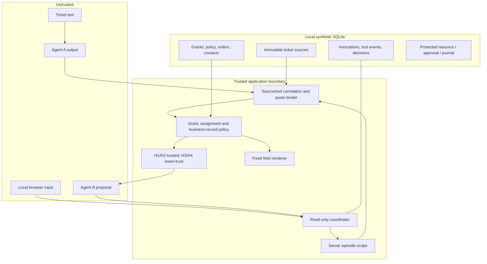

# Architecture

This document describes checked-in code separately from the proposed hosted Live AI architecture. The application is a local synthetic reference; module boundaries organize authority but are not an OS process sandbox.

## System context

## Component and trust ownership

## Implemented components and trust

| Component | Responsibility, inputs and outputs | Trust / failure treatment | Status and source |
|---|---|---|---|
| Agent contracts/prompts | Strict A/B candidate shapes and role prompts | Model response remains untrusted; schema errors fail the episode | Implemented: [`agents/`](../src/scoperelay/agents/) |
| Provider adapter | OpenAI-compatible transport, bounded calls, native tool calls and response metadata | Explicit constructor authorization/config required; transport errors are failures, not policy denials | Implemented; live calls require explicit configuration and gate: [`adapter.py`](../src/scoperelay/inference/adapter.py) |
| Read-only coordinator | Pins episode protocol, runs A tool/continuation, validates candidate, evaluates trusted facts, builds handoff, runs B tool/continuation, persists correlated records | Does not import or invoke protected resource; malformed output does not create authority | Implemented: [`read_only_agents.py`](../src/scoperelay/application/read_only_agents.py) |
| Tool dispatcher/repositories | Enforce exactly one tool per role against server-owned episode/grant/handoff/verification scope | Wrong role, ID, call ID, args, or missing scope fails closed | Implemented: [`tool_dispatcher.py`](../src/scoperelay/trusted/tool_dispatcher.py), [`agent_reads.py`](../src/scoperelay/storage/agent_reads.py) |
| Quote binder | Correlates A observation to pinned source and derives exact source span | Checks occurrence and bounded relevance, not intent or authority | Implemented for V2: [`quote_binding.py`](../src/scoperelay/trusted/quote_binding.py) |
| Trusted policy | Reads assignment, grant, policy, source, business records and contacts; returns one closed decision and verified facts | Missing facts yield incomplete evidence; stale/forbidden/wrong scope denies; DB errors propagate | Implemented: [`authorization.py`](../src/scoperelay/trusted/authorization.py) |
| Handoff and renderer | Separates trusted H1/H2 from lower-trust H3/H4; renders allowlisted material | Model cannot select arbitrary body/recipient | Implemented: [`handoff.py`](../src/scoperelay/trusted/handoff.py), [`renderer.py`](../src/scoperelay/trusted/renderer.py) |
| Resource/approval | Rechecks current state, approval and identities at commit boundary; writes synthetic queue/journal outcomes | Protected resource is not exposed as an agent tool or public-showcase capability | Local implementation; protected release NO-GO: [`resource.py`](../src/scoperelay/trusted/resource.py), [`approval.py`](../src/scoperelay/trusted/approval.py) |
| SQLite/storage | Schema, migrations, fixtures, serialized writer ownership, continuity and recovery evidence | Local file trust; corruption or unknown state is not treated as denial/noncommit | Implemented with known rollback xfail: [`storage/`](../src/scoperelay/storage/) |
| Reviewer UI | Reads persisted local data and displays evidence/recovery states | Browser role/session security remains local-app scope; no hosted auth claim | Implemented: [`presentation/`](../src/scoperelay/presentation/) |
| Offline evaluator | Runs deterministic scripted turns in disposable DBs; oracle read starts after runtime messages/evidence are fixed | Scripts are not LLM behavior; zero generations and zero protected effects | Implemented: [`offline_scenarios.py`](../src/scoperelay/evaluation/offline_scenarios.py) |
| Static showcase | Builds reviewed data/trace into eight files | Static-only; no API-108/API-109 or provider call | Implemented: [`public_showcase.py`](../src/scoperelay/evaluation/public_showcase.py), [`apps/showcase/`](../apps/showcase/) |

## A → B lifecycle and authority boundary

1. A server-created episode pins `V1_SPANS` or `V2_EXACT_QUOTE` before invocation. A receives an assignment-specific prompt and may call `read_assigned_ticket` only.
2. The dispatcher derives the actual ticket/grant/source scope from trusted episode state, persists the tool event/observation and returns it to A's same conversation. The continuation is correlated before parsing.
3. Strict output parsing rejects extra fields. V2 binding checks source ID/version/digest/body and unique quotation occurrence; trusted code derives code-point offsets. Authorization separately evaluates grant, policy, ownership, verified contact, operation and source conditions.
4. For eligible routine status, trusted services construct H1 (authority) and H2 (verified facts); lower-trust A interpretation/source references remain separated as H3/H4.
5. B receives its bounded handoff and may call `read_verified_order_status` with the exact server-bound verification ID. Its actual result must return to the same B conversation before a bounded proposal is accepted.
6. The read-only coordinator ends at proposal/evidence. The protected resource is a distinct trusted subsystem. Public showcase and offline evaluator never invoke it.

## Static, current-live, and planned paths

The static showcase is built from the curated source with deterministic UTF-8 newline handling and checked against the frozen eight-file artifact manifest. Historical replay is recorded evidence, not a fresh call. Offline evaluation runs deterministic scripts. Provider transport and a local sandbox execution path exist in code; a prior Task 07G report documents one bounded local Ollama SC-01 A→B run. This does not make a hosted playground operational or authorized.

The separately maintained [Live Playground architecture](architecture/LIVE_PLAYGROUND_ARCHITECTURE.md) is a local implementation/design record, not deployed infrastructure. ADR-019 approves exact-quotation binding for offline implementation; ADR-020 approves the separate synthetic no-effect sandbox architecture. Neither authorizes public deployment, hosted inference, paid infrastructure, or protected actions. The future hosted topology described there is a separate diagram/design, not an implementation claim.
