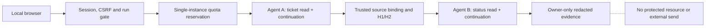

# Local Live AI Playground architecture

This document explains the locally implemented no-effect route. It does **not** approve hosted traffic or assert that a real model smoke has run in this task. The canonical S5 boundaries and [ADR-020](adr/ADR-020_PUBLIC_SANDBOX_PROPOSAL.md) take precedence.

## Request lifecycle



```text
Loopback browser + owner-scoped cookie/CSRF
  -> strict RunInput + GUIDED/SC-01/LIVE gate
  -> atomic session/idempotency/concurrency/day reservation
  -> isolated per-run synthetic database, no evaluator truth
  -> ProviderAdapter (fixed local Ollama v1, gemma4:e4b, <=4 requests)
  -> Agent A: actual ticket read tool -> result -> continuation
  -> trusted unique exact-quotation/source binding and policy evaluation
  -> H1/H2 independent facts + H3/H4 lower-trust data
  -> Agent B: actual verified-status read tool -> result -> continuation
  -> bounded proposal + sanitized owner-only trace

  X no API-108/API-109, approval, queue writer or external delivery
```

`ReadOnlyAgentRunner` and `ProviderAdapter` retain the approved two-agent semantics. Agent B runs only when independently evaluated eligibility permits it. The browser cannot choose a provider, model, endpoint, grant, verified contact or tool. A source quote proves a unique exact occurrence and relevance check, not true current customer intent. The sandbox does not translate `ALLOW` into a protected effect.

## Local controls and trade-offs

`src/scoperelay/sandbox/__main__.py` binds `127.0.0.1` and holds the existing single-instance OS lease. The new `--enable-local-live-ollama` flag is rejected unless `SCOPERELAY_LOCAL_LIVE_AUTHORIZED=YES` is separately set by the operator. `create_sandbox_app` defaults `local_live_enabled=False`. When enabled, only guided synthetic SC-01 can use LIVE. Four turns are reserved once per run from the existing 40-turn UTC-day local budget; the adapter has `max_requests=4`, retries disabled and a fixed local model endpoint. No page load invokes a model. Failure retains reserved slots; idempotent replay does not generate again.

Local SQLite transactions are suitable for this single-host prototype, **not** distributed public quotas. `run_inference` is a separate table to keep the existing crash/recovery row contract. For terminal runs, `model_requests` counts adapter dispatch attempts, including failed requests. If a LIVE worker is interrupted before final accounting, `model_invoked=null` and `request_count_note=UNKNOWN_AFTER_INTERRUPTION`; on a technical error after dispatch, `model_invoked=null` and `request_count_note=DISPATCHED_PROCESSING_UNKNOWN`. Neither a stored zero nor an attempted SDK call proves what the model processed. Real provider usage is shown only when the provider returned usage metadata; no token or rupee value is fabricated.

The per-run database still uses the canonical schema with empty reserved protected tables. HTTP route isolation and no writer import are useful but **not** a public process capability boundary. Before any public live service, provision a minimal no-effect schema or distinct constrained storage role and prove no protected database, writer credential, mount or network path is reachable. The existing local CLI must never be exposed via a public proxy unchanged.

## Reproduction without inference

From the isolated source root, with Python 3.13.x and the frozen `uv.lock`:

```powershell
uv run --locked pytest -q tests-expanded/test_local_live_gate.py -o addopts=''
uv run --locked python -m scoperelay.sandbox --help
```

The tests use a fake SDK response and make **zero** model-generation requests. Running the CLI with live flags or an actual Ollama model is a separate authorization and validation step. See the [current verification record](../evidence/ENGINEERING_VERIFICATION.md) and [cost controls](../delivery/COST_AND_ABUSE_CONTROLS.md).
