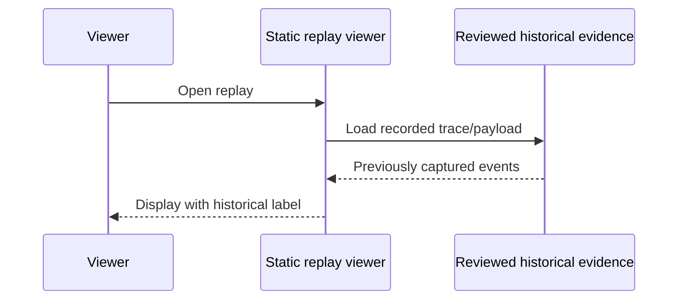
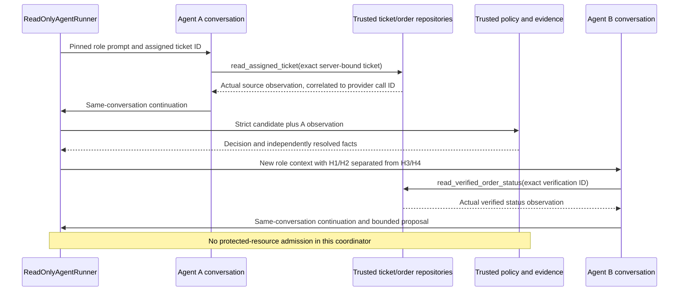
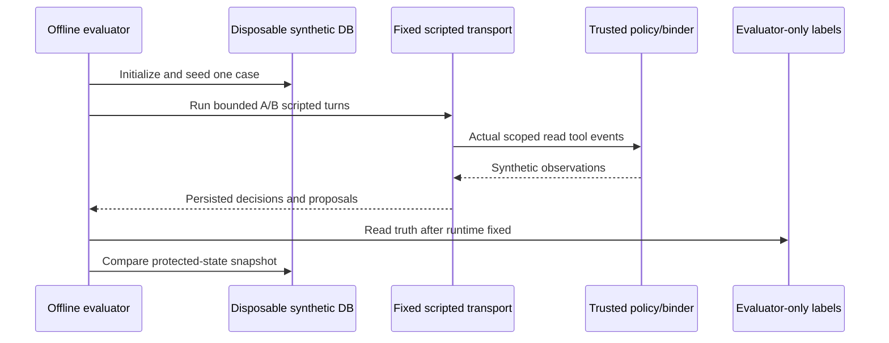
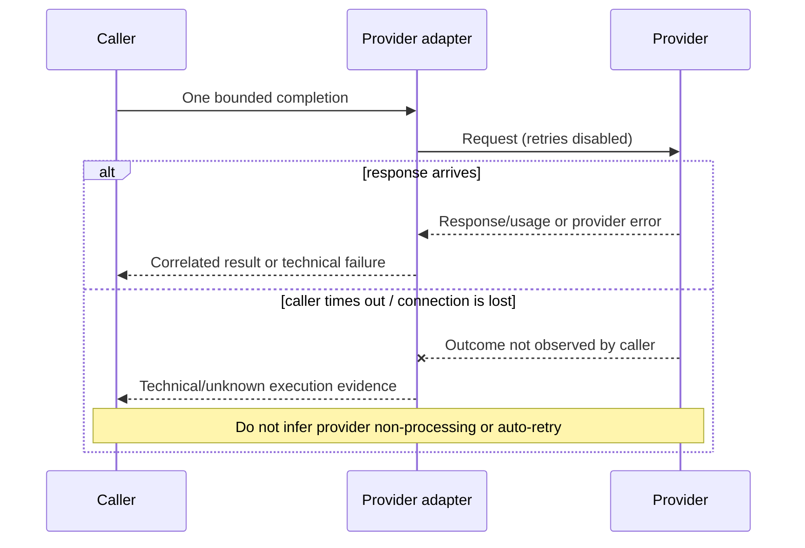

# Execution lifecycle and failure semantics

## Historical replay (recorded, no new inference)



The viewer cannot show a new provider invocation. See [Task 07G provenance](evidence-and-provenance.md).

## Actual bounded A → B model path



This sequence describes the implemented local runner when supplied a real `ProviderAdapter`; the historical Task 07G report is evidence for one prior local live run. Scripted tests exercise the same orchestration shape but are not model invocations.

## Deterministic offline case



No provider requests or protected effects occur. The script is test input, not a model output sample.

## Current local model execution path (when explicitly authorized/configured)

`ReadOnlyAgentRunner` pins the episode protocol, performs A's native read-tool turn and same-conversation continuation, validates and binds A evidence, evaluates trusted policy and constructs the handoff, then performs B's separately scoped tool call and continuation. Provider failure, malformed output, or missing continuation yields recorded failure/incomplete evidence; none is rewritten as a denial. The bounded Task 07G historical run is evidence of a prior local execution, not this document performing inference.

## Policy rejection, missing evidence, and clarification

The trusted evaluator checks current server-owned records after A output. A stale/forbidden/wrong-owner path can `DENY`; missing records can return `INCOMPLETE EVIDENCE`; ambiguous or quoted-only source can return `CLARIFY` with an unsent draft. None of these decision outcomes by themselves indicates that a protected resource was attempted.

```mermaid
sequenceDiagram
  participant A as Agent A candidate
  participant Trust as Trusted binder and policy
  participant DB as Synthetic records
  participant B as Agent B
  A->>Trust: Candidate plus correlated source evidence
  Trust->>DB: Current assignment/grant/policy/order/contact reads
  alt forbidden, stale, wrong owner or unsupported
    DB-->>Trust: Conflict / restricted facts
    Trust-->>A: DENY or INCOMPLETE EVIDENCE; persist decision
    Note over Trust,B: No routine handoff/proposal; no effect attempt
  else ambiguous intent
    DB-->>Trust: Records insufficient to disambiguate
    Trust-->>A: CLARIFY with unsent draft
    Note over Trust,B: No B execution or send
  else routine verified
    DB-->>Trust: Independently verified facts
    Trust->>B: H1/H2 plus separated lower-trust H3/H4
  end
```

## Timeout and unknown result

For provider inference, timeout means the client did not obtain a usable response; it does not prove whether the provider processed the request. The adapter disables SDK retry. For resource admission, possible commit followed by lost acknowledgment remains `INDETERMINATE` until same-identity authoritative reconciliation establishes the result. Never mint a replacement action identity to hide uncertainty.



## Coherent rollback limitation

The test `tests/security/test_writer_lifecycle_04e.py` includes one known xfail concerning coherent rollback of all related state. It remains visible in results. This is a release blocker for protected effects, not evidence that a rollback was detected.

```mermaid
sequenceDiagram
  participant Resource as Protected resource
  participant DB as SQLite/journal
  participant Recovery
  Resource->>DB: Serialized original-identity admission
  DB-->>Resource: Commit may have occurred
  Note over Resource,DB: Coherent rollback of all correlated state is the known xfail
  Recovery->>DB: Inspect original identity and continuity witness
  alt authoritative commit evidence
    DB-->>Recovery: Reconciled committed
  else authoritative terminal noncommit evidence
    DB-->>Recovery: Reconciled not committed
  else ambiguous / coherently rolled back
    DB-->>Recovery: Insufficient evidence
    Recovery-->>Resource: INDETERMINATE; block new identity
  end
```
