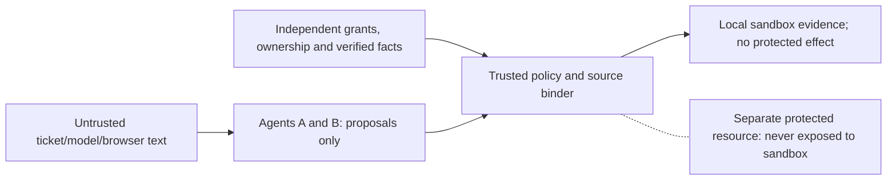

# Trust boundary and threat model — local playground delta

The canonical [threat model](THREAT_MODEL.md) and [authorization policy](AUTHORIZATION_POLICY.md) remain binding. This delta covers the new optional local LIVE route, not a professional audit.

| Attacker/input | Boundary and control | Test/evidence | Residual |
| --- | --- | --- | --- |
| Visitor supplies fake SYSTEM/manager instructions | Ticket text remains H3/H4 lower trust; H1/H2 come from trusted fixtures | Existing sandbox adversarial tests and original authorization tests | Model may make a wrong-but-allowed semantic choice |
| Visitor chooses another tenant/tool/model | Server accepts only SC-01 GUIDED LIVE; provider/model/URL fixed; runner tool scope closed | `test_local_live_gate.py` wrong scenario and no-effect tests | Any new public endpoint requires separate review |
| Forged quote or B observation | Exact unique source binding; B event ID tied to actual tool observation and continuation | Existing quote-binding and sandbox tests; mock-SDK A→B path | Genuine local model compatibility not re-proven here |
| Session/evidence ID substitution | Opaque cookie, CSRF, owner check on every run/evidence read | Existing 10A–10D cross-visitor, CSRF, expiry tests | Local cookie is not HTTPS/Secure-public configuration |
| Replay or capacity abuse | Idempotency key/body hash, five runs/session, 40 reserved turns/day, max four LIVE requests/run, operator kill switch | Existing quota/replay/race tests and new idempotent mock path | Not a multi-instance public cost ceiling |
| Provider timeout/partial run | Fixed safe error; no model text in error; interrupted LIVE invocation unknown | Mock timeout test; crash-recovery suite | Actual Ollama smoke and power-loss test not performed |
| Browser injection/secret disclosure | DOM uses text nodes/textContent, no provider key in JS; loopback Host/Origin/CSP guards | Edge QA 1440/1024/768/390/320; focused secret-prefix scan | Full public secret/history audit and manual assistive-tech review pending |
| Protected action attempt | Sandbox has no API-108/API-109 route or protected writer import; no effect path in runner | No-effect tables checked in mock success/failure tests | Full canonical schema still creates empty protected tables; public process separation not proved |

No unrestricted shell, visitor-supplied URL fetch, real customer connector, external send or payment route is implemented in the local sandbox. That is a code observation, not formal sandbox containment. This review self-verified code and tests; it is **not a professional security audit**. Public/live launch remains NO-GO pending a separate process/store threat review and fresh entitlement/cost checks.
